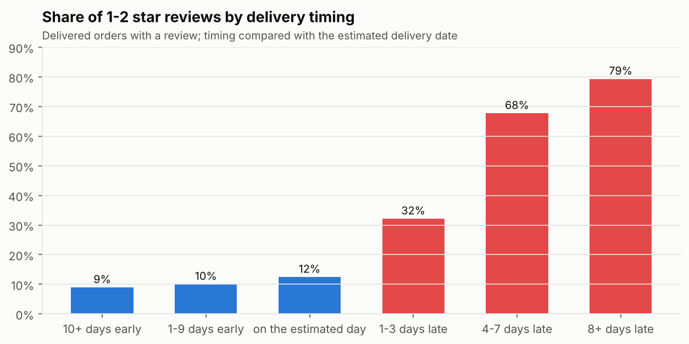
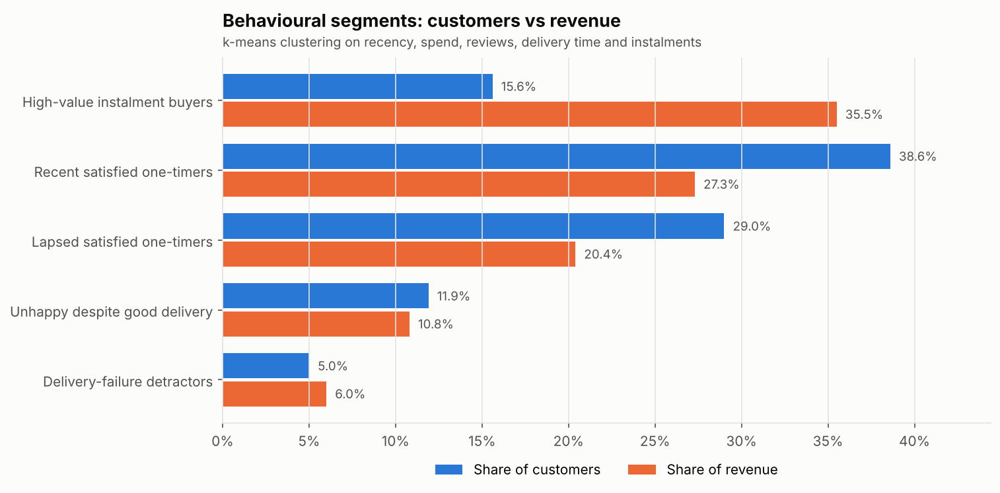

# Olist Customer & Seller Intelligence

An end-to-end analytics project on **~100,000 real orders** from Olist, a Brazilian
e-commerce marketplace. It takes messy raw data through a tested SQL data model to
business findings and recommendations.

**Business question:** *Where is the marketplace losing revenue and customer goodwill, and what should it fix first?*

## Key findings

### Phase 1: performance and service

| | Finding |
|---|---|
| 📈 | Revenue grew **141% year on year** (Jan to Aug 2018 vs 2017), then **plateaued** at R$0.83m to R$0.98m a month. |
| 🚚 | **Late orders are 6.7% of deliveries but 32.5% of 1-2 star reviews.** Low-review share jumps from ~10% when on time to 79% when 8+ days late. |
| 🔁 | Only **3.0% of customers ever order again** (2.2% on a separate day), though repeat customers spend about twice as much. |
| 🏪 | The **top 10% of sellers generate 67% of revenue**; sellers with 15%+ late rates average 3.68 stars vs 4.28 for the most reliable. |
| 🗺️ | **Rio de Janeiro**, the second-largest market, has a 12.1% late rate, almost triple São Paulo's 4.5%. |



➡️ **Full write-up: [docs/phase1_findings.md](docs/phase1_findings.md)**

### Phase 2: customer segmentation

| | Finding |
|---|---|
| 💰 | **Lapsing big spenders** are 22.7% of customers but hold **41.1% of customer spend**, the clearest win-back target. |
| 💳 | **High-value instalment buyers** (15.6% of customers, 7.8 instalments on average) generate **35.5% of spend**. |
| 😠 | About **1 in 6 customers had a bad experience**, and clustering splits them into two distinct problems: **delivery failures** (81% got a late order) and **unhappy despite good delivery** (only 10% did), which points to product and seller issues. |



➡️ **Full write-up: [docs/phase2_findings.md](docs/phase2_findings.md)**

### Power BI dashboard

A four-page dashboard (executive overview, delivery and satisfaction, customer segments,
seller scorecard) built on an exported star schema, with DAX measures and a custom theme.
See the **[build guide](docs/powerbi_guide.md)** and the [`powerbi`](powerbi) folder.

## What this project demonstrates

- **SQL data modelling:** a layered model (raw → staging → marts) with fact and
  dimension tables, window functions, CTEs and deduplication logic.
- **Data quality testing:** 14 automated tests (uniqueness, referential integrity,
  revenue reconciliation, valid ranges) that run on every build.
- **Customer segmentation:** RFM scoring adapted for a low-repeat marketplace, plus
  k-means clustering in Python (scikit-learn) with a documented choice of k.
- **BI modelling:** a Power BI star schema, date table and DAX measures (YoY growth,
  late share of low reviews, segment share of spend).
- **Analytical judgement:** e.g. separating same-day split baskets from genuine return
  visits, limiting trends to complete months, and choosing 5 clusters over the
  statistically "best" 3 because they lead to different actions.
- **Communication:** findings written for a business audience, with clear caveats.

## Data model

```
data/raw/*.csv ──load_raw.py──▶ raw_* tables (as-is copies of the source files)
                                   │
                       sql/staging ▼  cleaned views: types, dedup, translations
                                stg_* views
                                   │
                         sql/marts ▼  analysis-ready tables
          fct_orders · fct_order_items · dim_customers · dim_sellers · dim_products
          dim_geolocation · dim_states · mart_customer_features (RFM)
                                   │
                         sql/tests ▼  14 data quality checks (build fails if any fail)
                                   │
              segment_customers.py ▼  k-means segments → customer_segments
                                   │
                      sql/analysis ▼  13 business questions → outputs/tables + outputs/charts
                                   │
                 export_powerbi.py ▼  star-schema CSVs → Power BI dashboard
```

| Table | Grain | Used for |
|---|---|---|
| `fct_orders` | one row per order | revenue, delivery performance, reviews |
| `fct_order_items` | one row per item | category and seller revenue |
| `dim_customers` | one row per real customer | retention, RFM inputs |
| `dim_sellers` | one row per seller | seller performance |
| `dim_products` | one row per product | categories (English names) |
| `dim_geolocation` | one row per zip prefix | maps (later phases) |
| `dim_states` | one row per state | state names and macro-regions |
| `mart_customer_features` | one row per customer | segmentation features, RFM scores and segments |
| `customer_segments` | one row per customer | k-means behavioural segment (from Python) |

### Data cleaning decisions

- **Customers:** `customer_id` is generated per order, so person-level analysis uses `customer_unique_id`.
- **Reviews:** 547 orders have multiple reviews; the most recently answered one is kept.
- **Categories:** translated to English; 610 uncategorised products are labelled `unknown`.
- **Delivery:** "late" means delivered after the estimated date shown to the customer. 8 delivered orders with no delivery date are excluded from delivery metrics.
- **Time window:** trend charts use Jan 2017 to Aug 2018, because the months before and after are incomplete.
- **Geolocation:** ~1M points collapsed to one centroid per zip prefix, excluding points outside Brazil.

## Analysis questions

| # | Question | Query |
|---|---|---|
| 1 | How are orders and revenue trending monthly? | [01_monthly_growth](sql/analysis/01_monthly_growth.sql) |
| 2 | How much did the business grow year on year? | [02_year_over_year](sql/analysis/02_year_over_year.sql) |
| 3 | How many customers return, and what are they worth? | [03_repeat_customers](sql/analysis/03_repeat_customers.sql) |
| 4 | How long until a customer's second order? | [04_days_to_second_order](sql/analysis/04_days_to_second_order.sql) |
| 5 | How does delivery timing affect reviews? | [05_delivery_vs_reviews](sql/analysis/05_delivery_vs_reviews.sql) |
| 6 | Which categories drive revenue? | [06_category_performance](sql/analysis/06_category_performance.sql) |
| 7 | How concentrated is revenue among sellers? | [07_seller_concentration](sql/analysis/07_seller_concentration.sql) |
| 8 | Do sellers with more late deliveries get worse reviews? | [08_seller_service_quality](sql/analysis/08_seller_service_quality.sql) |
| 9 | How does delivery vary by state? | [09_state_delivery](sql/analysis/09_state_delivery.sql) |
| 10 | How do customers pay? | [10_payment_methods](sql/analysis/10_payment_methods.sql) |
| 11 | What are the RFM segments worth? | [11_rfm_segments](sql/analysis/11_rfm_segments.sql) |
| 12 | What do the behavioural segments look like? | [12_customer_clusters](sql/analysis/12_customer_clusters.sql) |
| 13 | Which categories over-index among unhappy customers? | [13_unhappy_segment_drivers](sql/analysis/13_unhappy_segment_drivers.sql) |

## How to run it

Requires Python 3.10+.

```bash
pip install -r requirements.txt
```

1. Download the [Brazilian E-Commerce Public Dataset by Olist](https://www.kaggle.com/datasets/olistbr/brazilian-ecommerce) from Kaggle and put the 9 CSV files in `data/raw/`. (The data is not committed to this repo.)
2. Run the whole pipeline with one command:

```bash
python scripts/run_all.py
```

or step by step:

```bash
python scripts/load_raw.py           # load CSVs into data/olist.db (SQLite)
python scripts/build.py              # build models and run the data quality tests
python scripts/segment_customers.py  # k-means customer segmentation
python scripts/run_analysis.py       # run the analysis, save tables and charts
python scripts/export_powerbi.py     # export CSVs for the Power BI dashboard
```

To explore the data yourself:

```bash
python scripts/query.py "select customer_state, count(*) from fct_orders group by 1"
```

## Project structure

```
├── data/raw/              source CSVs (git-ignored)
├── docs/                  findings write-ups and Power BI build guide
├── outputs/
│   ├── charts/            charts (PNG)
│   └── tables/            analysis results (CSV)
├── powerbi/               DAX measures, theme (data/ is generated and git-ignored)
├── scripts/               pipeline scripts
└── sql/
    ├── staging/           cleaning views
    ├── marts/             fact and dimension tables
    ├── tests/             data quality tests
    └── analysis/          business questions
```

## Roadmap

- [x] **Phase 1:** data model, quality tests, exploratory SQL analysis
- [x] **Phase 2:** customer segmentation (RFM + clustering) and Power BI data model
- [ ] **Phase 2b:** Power BI dashboard screenshots
- [ ] **Phase 3:** repeat-purchase model with explainability, seller scorecard
- [ ] **Phase 4:** review text analysis (NLP), demand forecasting, business memo

## Data source

Olist, *Brazilian E-Commerce Public Dataset* (Kaggle), released under CC BY-NC-SA 4.0.
