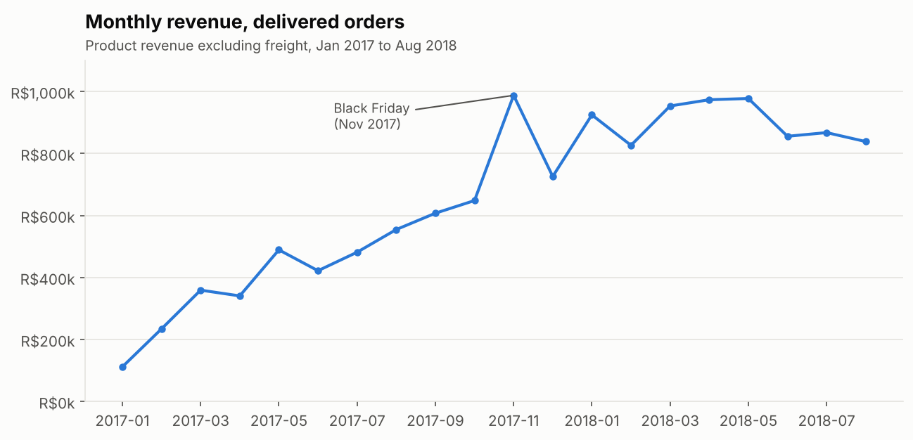
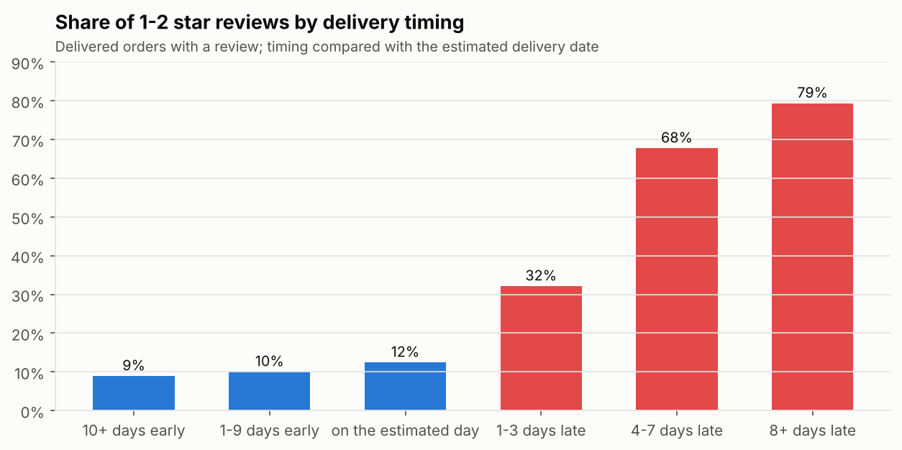
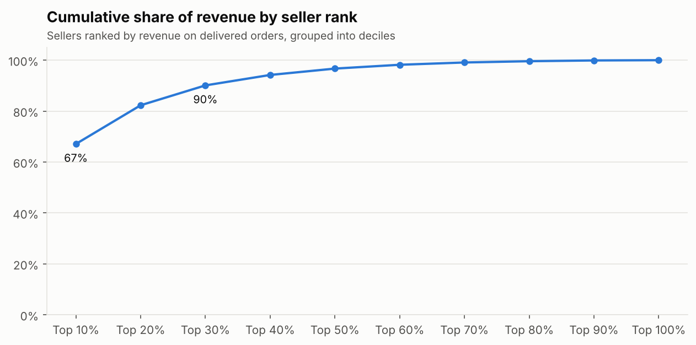
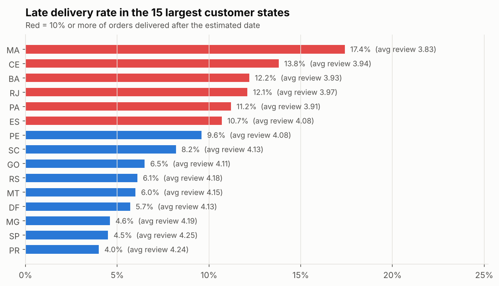

# Phase 1 findings: where is the marketplace losing value?

**Scope:** 99,441 orders placed on the Olist marketplace (Brazil), Sept 2016 to Oct 2018.
Trend analysis uses complete months only (Jan 2017 to Aug 2018). Unless stated,
figures use delivered orders, and revenue means product price excluding freight.
Every number below comes from a query in [`sql/analysis`](../sql/analysis), with
results saved in [`outputs/tables`](../outputs/tables).

## Summary

1. **The business more than doubled, then plateaued.** Revenue for Jan to Aug 2018 was
   141% higher than the same months of 2017, but monthly revenue has been flat at
   roughly R$0.83m to R$0.98m since early 2018.
2. **Late delivery is the biggest driver of bad reviews.** Only 6.7% of delivered
   orders arrive late, yet they account for 32.5% of all 1 and 2 star reviews.
3. **Almost nobody comes back.** Just 3.0% of customers placed more than one order,
   and only 2.2% bought on more than one day.
4. **Revenue is concentrated in a small group of sellers.** The top 10% of sellers
   generate 67% of revenue, and the top 30% generate 90%.
5. **Service quality varies by region.** Customers in Rio de Janeiro and the North
   and Northeast wait longer, are delivered late more often, and rate orders lower.

## 1. Growth: strong, then flat

- Jan to Aug 2018: 52,777 delivered orders and R$7.22m revenue, up from 21,997 orders
  and R$2.99m in Jan to Aug 2017 (orders +140%, revenue +141%).
- The peak month was November 2017 (Black Friday), at R$0.99m.
- Through 2018, revenue stayed between about R$0.83m and R$0.98m a month, and dipped
  from June to August. Growth has stalled, which makes retention and service quality
  more important levers than they were in 2017.

*Source: `01_monthly_growth`, `02_year_over_year`.*

## 2. Delivery is what customers punish

- Orders delivered on or before the estimated date receive a 1 or 2 star review
  9% to 12% of the time.
- That rises to 32% when an order is 1 to 3 days late, 68% at 4 to 7 days late, and
  79% at 8 or more days late. The average score falls from 4.32 to 1.70.
- Late orders are 6.7% of delivered orders but 32.5% of low reviews.
- Estimates are very cautious: the average estimate is 23.7 days against an actual
  12.6 days, and 64% of orders arrive 10 or more days early.

**Implication:** reducing late deliveries is likely the fastest way to improve
customer satisfaction. Because estimates are so conservative, there may also be room
to show shorter, still-reliable estimates at checkout. That is a hypothesis to test,
since this data cannot show how estimates affect conversion.

*Source: `05_delivery_vs_reviews`.*

## 3. Retention is extremely low

| Measure | Value |
|---|---|
| Customers (delivered orders) | 93,350 |
| Placed more than one order | 2,801 (3.0%) |
| Bought on more than one day | 2,015 (2.2%) |
| Share of revenue from repeat customers | 5.6% |
| Average spend: repeat vs one-time customers | R$308.53 vs R$160.73 |

- Of customers who placed a second order, 30.5% did so on the same day. These are
  often one basket split across sellers rather than true return visits, which is why
  the project tracks "returning" customers (more than one purchase day) separately.
- Beyond same-day orders, return timing is spread out: of all customers with a second
  order, 20% returned within 1 to 30 days and 17% after more than 180 days.

**Implication:** the marketplace runs almost entirely on new customers. Even a small
gain in repeat purchases would be material, because repeat customers spend about
twice as much.

*Source: `03_repeat_customers`, `04_days_to_second_order`.*

## 4. Sellers: concentrated revenue, uneven service

- 297 sellers (the top 10%) generate 67.1% of revenue. The top 30% generate 90.1%.
- Among sellers with at least 30 delivered orders, service quality tracks reviews
  closely:

| Seller late-delivery rate | Sellers | Avg review | Share of 1-2 star reviews |
|---|---|---|---|
| Under 5% | 283 | 4.28 | 10.0% |
| 5% to 10% | 215 | 4.14 | 13.1% |
| 10% to 15% | 92 | 4.01 | 16.4% |
| 15% or more | 37 | 3.68 | 24.4% |

**Implication:** a seller performance programme can be targeted. A small group of
high-revenue sellers matters most commercially, and 37 established sellers with
late-delivery rates of 15% or more are the clearest candidates for intervention.

*Source: `07_seller_concentration`, `08_seller_service_quality`.*

## 5. Regional gaps

- São Paulo (SP) accounts for 42% of delivered orders, with an 8.8-day average
  delivery, a 4.5% late rate and an average review of 4.25.
- Rio de Janeiro (RJ), the second-largest market, has a 12.1% late rate and an
  average review of 3.97, despite being close to São Paulo.
- Northeastern states fare worst among larger markets: Maranhão (MA) 17.4% late,
  Ceará (CE) 13.8%, Bahia (BA) 12.2%. Freight is also higher there (R$42.95 average
  per order in MA against R$17.33 in SP).

**Implication:** RJ stands out as a large market with an unusually high late rate,
which makes it a priority for a logistics review.

*Source: `09_state_delivery`.*

## 6. Other context

- **Categories:** the top five categories (health and beauty, watches and gifts, bed
  bath and table, sports and leisure, computer accessories) make up 39.8% of revenue.
  Office furniture has the weakest average review among the top 15 (3.64). *Source:
  `06_category_performance`.*
- **Payments:** 75.5% of orders are paid mainly by credit card, averaging 3.5
  instalments, and 19.9% by boleto (bank slip). *Source: `10_payment_methods`.*

## Recommendations (to be tested in later phases)

1. **Tackle late deliveries first,** starting with high-late-rate sellers and the RJ
   and Northeast routes. Track late rate and 1-2 star review share as the core KPIs.
2. **Launch a seller performance scorecard** covering late rate, cancellations and
   reviews, with support or penalties for persistent underperformers. (Phase 3.)
3. **Build a retention programme** aimed at first-time buyers, informed by customer
   segmentation and a repeat-purchase model. (Phases 2 and 3.)

## Limitations

- This is a public sample of Olist orders, not the complete business.
- Reviews exist for about 99% of orders, but reviewers may differ from non-reviewers.
- Late delivery is defined against Olist's own estimated date, so it reflects the
  promise made to the customer, not absolute speed.
- These findings show associations. They do not prove that late delivery causes low
  reviews, although the pattern is strong and consistent.
