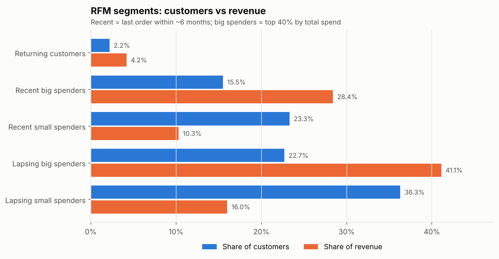
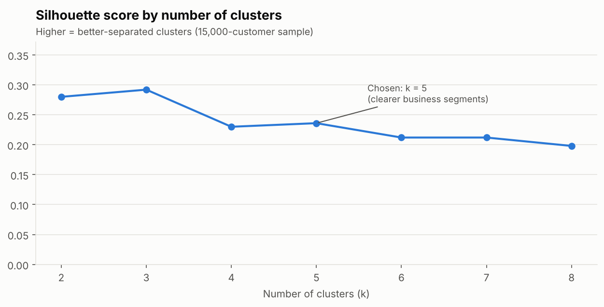
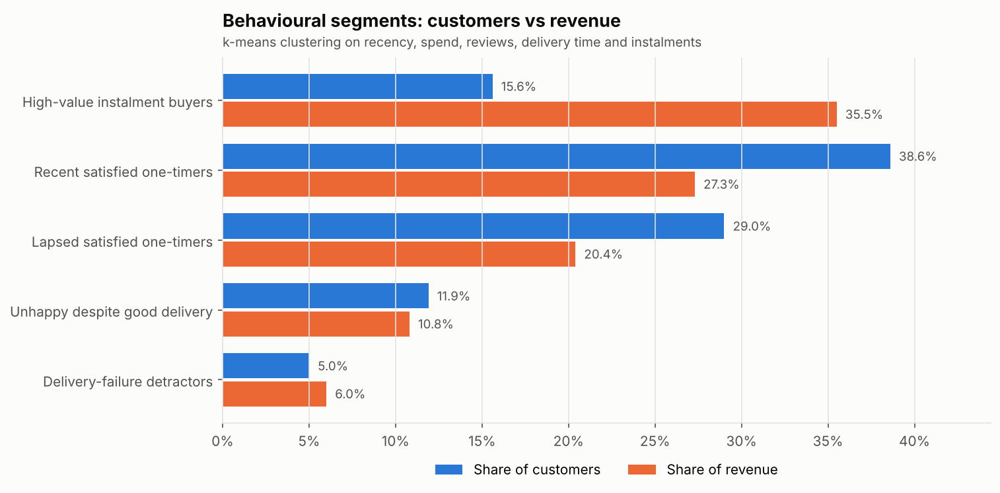

# Phase 2 findings: who are the customers, and who should we act on?

**Scope:** the 93,350 customers with at least one delivered order. Two complementary
segmentations are used:

- **RFM segments** (rule-based): simple and explainable, built in SQL
  ([`08_mart_customer_features.sql`](../sql/marts/08_mart_customer_features.sql)).
- **Behavioural segments** (k-means clustering): data-driven, using delivery and review
  experience as well as value ([`segment_customers.py`](../scripts/segment_customers.py)).

Figures come from [`11_rfm_segments`](../sql/analysis/11_rfm_segments.sql),
[`12_customer_clusters`](../sql/analysis/12_customer_clusters.sql) and
[`13_unhappy_segment_drivers`](../sql/analysis/13_unhappy_segment_drivers.sql).

## Summary

1. **The biggest revenue pool is customers who are drifting away.** "Lapsing big spenders"
   are 22.7% of customers but hold 41.1% of all customer spend.
2. **A small, high-value group pays in instalments.** 15.6% of customers average 7.8
   instalments and generate 35.5% of spend, more than twice their share of customers.
3. **About 1 in 6 customers had a bad experience,** and they split into two different
   problems: **delivery failures** (5.0% of customers, 81% received a late order) and
   **dissatisfaction despite good delivery** (11.9%, only 10% received a late order).
4. The second group points to **product or seller problems**, concentrated in office
   furniture, telephony, computer accessories and bed/bath/table.

## 1. Why classic RFM needs adapting here

Standard RFM scores Recency, Frequency and Monetary value. In this marketplace 97% of
customers bought only once, so Frequency barely varies. The project therefore:

- scores **Recency** and **Monetary** in quintiles (1 = worst, 5 = best), using
  `percent_rank` so that customers with tied values always receive the same score;
- treats **Frequency** as a single flag: *returning* = bought on more than one day.

## 2. RFM segments

| Segment | Rule | Customers | Share of spend | Avg spend | Avg days since last order |
|---|---|---|---|---|---|
| Returning customers | bought on 2+ days | 2.2% | 4.2% | R$320.74 | 192 |
| Recent big spenders | R ≥ 4, M ≥ 4 | 15.5% | 28.4% | R$302.51 | 92 |
| Recent small spenders | R ≥ 4, M ≤ 3 | 23.3% | 10.3% | R$72.94 | 90 |
| Lapsing big spenders | R ≤ 3, M ≥ 4 | 22.7% | 41.1% | R$299.19 | 336 |
| Lapsing small spenders | R ≤ 3, M ≤ 3 | 36.3% | 16.0% | R$72.59 | 338 |

"Recent" means a last order within roughly 6 months (R ≥ 4 covers up to 177 days);
"big spenders" are the top 40% by total spend (M ≥ 4 starts at R$132.65).

**Implication:** the 21,187 lapsing big spenders are the clearest win-back target. They
have already shown they will spend about R$300, and they hold the largest share of value.

## 3. Behavioural segments (k-means)

**Features:** days since last purchase, total spend (log-scaled, because spend is heavily
skewed), average review score, average delivery time and average number of instalments.
All features were standardised so no single unit dominates.

**Choosing the number of segments:**

The silhouette score (a measure of how well-separated clusters are) peaks at k = 3
(0.292), but k = 5 (0.236) was chosen. At k = 3, the two different problems in section
4 below merge into one "unhappy" group, which hides the distinction that matters most
for action. The trade-off is slightly less separated clusters in exchange for segments
that lead to different interventions.

| Segment | Customers | Share of spend | Avg spend | Avg review | Avg delivery | Got a late order | Avg instalments |
|---|---|---|---|---|---|---|---|
| High-value instalment buyers | 15.6% | 35.5% | R$376.61 | 4.42 | 12.2 days | 3.1% | 7.8 |
| Recent satisfied one-timers | 38.6% | 27.3% | R$116.79 | 4.70 | 9.8 days | 2.1% | 1.8 |
| Lapsed satisfied one-timers | 29.0% | 20.4% | R$116.11 | 4.64 | 11.5 days | 1.6% | 2.0 |
| Unhappy despite good delivery | 11.9% | 10.8% | R$150.73 | 1.79 | 13.1 days | 10.2% | 2.3 |
| Delivery-failure detractors | 5.0% | 6.0% | R$198.82 | 1.88 | 40.3 days | 80.6% | 3.2 |

Segments are named from their average profile in code, not by hand, so the names stay
correct if the clustering is re-run.

## 4. Two different kinds of unhappy customer

Both unhappy segments average under 2 stars, but for different reasons:

- **Delivery-failure detractors** waited 40 days on average, and 81% received a late
  order. Their problem is logistics, which links directly to the phase 1 finding that
  late orders drive a third of low reviews.
- **Unhappy despite good delivery** customers received their orders in 13 days on average,
  and 90% had no late order. Something else went wrong: the product, its description,
  or the seller.

Categories most over-represented in the second group (customer's main category, categories
with 500+ customers; average across all customers is 11.9%):

| Category | Unhappy-despite-good-delivery rate |
|---|---|
| Office furniture | 16.0% |
| Telephony | 15.1% |
| Computer accessories | 14.5% |
| Bed, bath and table | 14.2% |

**Implication:** fixing delivery alone will not fix satisfaction. The review text for
this group (phase 4) should show what is going wrong in these categories.

## Recommendations

1. **Win back lapsing big spenders.** Target the 21,187 customers who spent about R$300
   but have not ordered for 6+ months (about 11 months on average), excluding those who
   left a low review, with a
   personalised offer in their previous category.
2. **Protect and grow the instalment buyers.** This group generates over a third of spend.
   Promote interest-free instalment options on higher-ticket categories and test whether
   highlighting them increases basket size.
3. **Recover detractors quickly.** When an order passes its estimated date, trigger a
   proactive message and a small voucher, rather than waiting for a 1-star review.
4. **Investigate product quality in the four flagged categories,** starting with seller
   and listing accuracy in office furniture and telephony.
5. **Convert recent satisfied one-timers** (the largest group, averaging 4.7 stars) with a
   follow-up offer, since they are happy but have not yet returned.

## Limitations

- The silhouette scores (0.2 to 0.3) show the segments overlap; they are useful groupings
  for action, not sharply distinct customer types.
- k-means assumes roughly round clusters and is sensitive to feature scaling; results
  were fixed with a random seed so they are reproducible.
- Recency is measured from the day after the last delivered purchase in the data
  (30 August 2018), not from today.
- Segments are a snapshot. In practice they would be refreshed regularly as customers
  move between groups.
