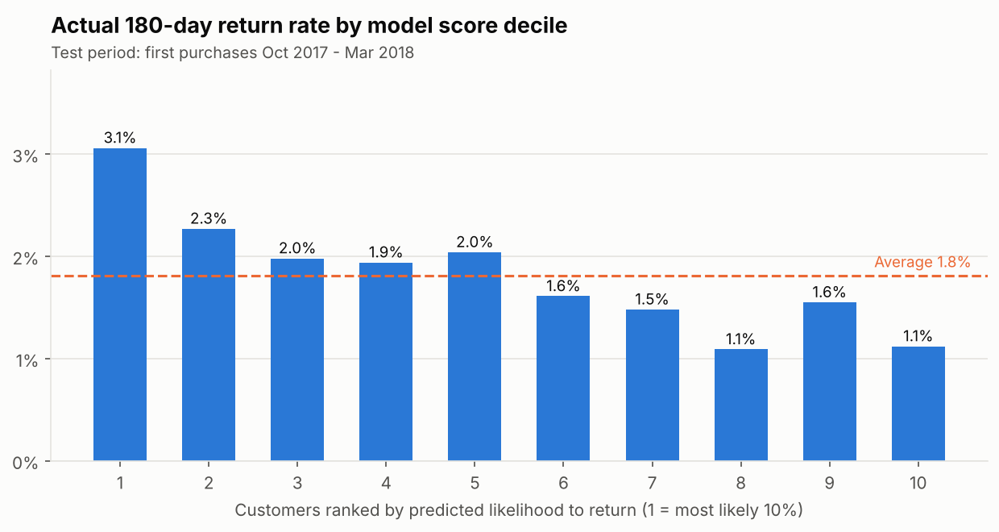
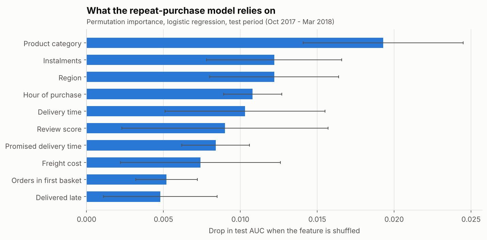
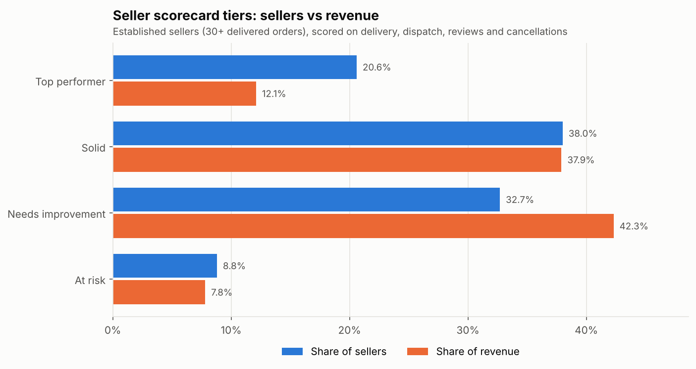

# Phase 3 findings: predicting repeat purchases, and scoring sellers

Phase 3 has two parts:

- **A repeat-purchase model** ([`train_repeat_model.py`](../scripts/train_repeat_model.py)):
  from a customer's first purchase, can we predict whether they will buy again?
- **A seller scorecard** ([`10_mart_seller_scorecard.sql`](../sql/marts/10_mart_seller_scorecard.sql)):
  a single 0-100 score and tier for every established seller.

## Summary

1. **Repeat purchases are hard to predict from the first order alone.** The best model
   reaches a test AUC of 0.58 (95% CI 0.56 to 0.61). That is real signal, clearly above
   chance, but weak. The 10% of customers it ranks highest return at 1.7 times the
   average rate.
2. **Simpler won.** Logistic regression beat gradient boosting (0.58 vs 0.56), and
   cross-validation chose the strongest regularisation tested. With a weak signal and a
   2% positive rate, a flexible model mostly fits noise.
3. **Product category, delivery speed and region matter most.** Customers whose first
   order arrived within a week return at 2.21%, against 1.51% when it took 21+ days, about
   a third lower. Fashion accessories, bed/bath/table and sports buyers return most often.
4. **Half of established-seller revenue sits with underperformers.** Sellers in the
   bottom two scorecard tiers are 41.5% of established sellers but hold 50.1% of their
   revenue, and 27 of the 50 biggest sellers are in those tiers.
5. **Late dispatch is the clearest seller problem.** "At risk" sellers hand 27% of items
   to the carrier after their own shipping deadline, against 2.4% for top performers.
   Unlike delivery time, dispatch is fully within the seller's control.

---

## Part A: repeat-purchase model

### Set-up

| | |
|---|---|
| **Question** | Will a customer buy again on a *later day* within 180 days of their first purchase? |
| **Customers** | 55,770 whose first purchase (Jan 2017 to Mar 2018) left a full 180-day window |
| **Return rate** | 2.0% (1,118 customers) |
| **Features** | first purchase only: basket size and value, freight, payment method and instalments, delivery time vs promise, review score, product category, region, time of purchase |
| **Split** | time-based: train on first purchases Jan to Sep 2017 (25,404 customers), test on Oct 2017 to Mar 2018 (30,366) |

Three choices keep the evaluation honest:
- **No future information in the features.** Everything describes the first purchase day.
- **Same-day orders do not count as returns,** since they are usually one basket split
  across sellers (see phase 1).
- **A time-based split rather than a random one,** because the model would be used to
  predict future customers from past ones.

### Results (test period)

| Model | ROC AUC (95% CI) | PR AUC | Return rate, top 10% | Lift, top 10% | Returners captured in top 20% |
|---|---|---|---|---|---|
| No-skill baseline | 0.500 | 0.018 | 1.8% | 1.0x | 20% |
| **Logistic regression** | **0.582** (0.560 to 0.606) | **0.025** | **3.1%** | **1.69x** | **29%** |
| Gradient boosting | 0.560 (0.536 to 0.584) | 0.024 | 2.8% | 1.56x | 28% |

The ranking works at the top: the highest-scored decile returns at 3.1% against an average
of 1.8%. Below the top two deciles, the model separates customers only weakly.

**What this means:** first-purchase data cannot reliably pick out the few customers who
come back. The model is useful for *prioritising* a retention budget (spend on the top
20% first and you reach 29% of future returners), but the bigger opportunity is raising
retention for everyone, plus collecting richer signals such as email engagement, browsing
and satisfaction surveys.

### What drives the predictions

Permutation importance measures how much the test AUC falls when one feature is shuffled.
Because several features are correlated (delivery time, promised time and lateness move
together), individual coefficients are unreliable, so the direction of each effect is shown
with simple return rates ([`14_repeat_purchase_drivers`](../sql/analysis/14_repeat_purchase_drivers.sql)):

| Factor | Higher return rate | Lower return rate |
|---|---|---|
| Product category | Fashion bags and accessories 3.2%, bed/bath/table 2.7%, sports and leisure 2.7% | Cool stuff 1.0%, computer accessories 1.5% |
| Delivery time | Under 7 days: 2.21% | 21+ days: 1.51% |
| Region | Southeast 2.17% | Northeast 1.46% |
| Instalments | 7 or more: 2.52% | One payment: 1.96% |
| Review score | 4-5 stars: 2.07% | 1-2 stars: 1.66% |

The delivery finding links back to phase 1: slow delivery does not only cost reviews, it
also makes a second purchase less likely.

### Scoring recent customers

The final model, refit on all 55,770 labelled customers, scores the **37,316 customers
whose first purchase was between March and August 2018** (their 180-day window had not
finished). Scores are in the `repeat_purchase_scores` table and the Power BI export
(`customer_return_scores.csv`). The top decile averages a 3.2% predicted return
probability, against 2.1% across all recent customers, which makes it a starting list
for a follow-up campaign.

---

## Part B: seller scorecard

### Method

The 627 established sellers (30+ delivered orders), who generate 77% of all revenue, are
scored on four "lower is better" metrics:

| Metric | Definition | Weight |
|---|---|---|
| Late delivery rate | order arrived after the promised date | 30% |
| Low review rate | share of reviewed orders rated 1-2 stars | 30% |
| Late dispatch rate | item handed to the carrier after the seller's shipping deadline | 25% |
| Cancellation rate | orders cancelled or unavailable | 15% |

Each metric becomes a percentile among established sellers, and the score is the weighted
average × 100. Tiers: **Top performer** (75+), **Solid** (50-75), **Needs improvement**
(25-50), **At risk** (under 25). The score is relative: 50 means "middle of the pack".

### Results

| Tier | Sellers | Share of revenue | Late delivery | Late dispatch | 1-2 star reviews | Avg review |
|---|---|---|---|---|---|---|
| Top performer | 129 | 12.1% | 2.2% | 2.4% | 6.5% | 4.44 |
| Solid | 238 | 37.9% | 5.2% | 5.5% | 10.9% | 4.23 |
| Needs improvement | 205 | 42.3% | 8.6% | 13.1% | 16.1% | 4.02 |
| At risk | 55 | 7.8% | 14.7% | 27.1% | 25.6% | 3.66 |

(Averages across sellers in each tier; revenue shares are of established-seller revenue.)

- **Big sellers are not the best sellers.** The bottom two tiers hold 50.1% of
  established-seller revenue, and 27 of the 50 highest-revenue sellers sit in them. High
  volume appears to strain dispatch.
- **Every service metric worsens together** from tier to tier, which supports combining
  them into one score.

---

## Recommendations

1. **Make late dispatch the first seller KPI.** It is seller-controlled, varies 11-fold
   between the top and bottom tiers, and feeds directly into late delivery and bad reviews.
2. **Support high-volume "Needs improvement" sellers** (for example with fulfilment help
   or dispatch reminders) rather than only penalising small ones: that is where half the
   revenue is.
3. **Review the 55 "At risk" sellers,** starting with the highest-revenue ones, with clear
   improvement targets.
4. **Prioritise retention spend with the model, but fix the basics for everyone.** Use
   the scores to sequence a follow-up campaign, and treat faster delivery as a retention
   lever as well as a satisfaction one.
5. **Collect better retention data** (email engagement, browsing, survey responses), since
   first-order data alone predicts repeat purchases only weakly.

## Limitations

- **Weak model:** an AUC of 0.58 supports prioritisation, not individual-level decisions.
- **Review timing:** reviews are usually written shortly after delivery, but a few may
  postdate a customer's return, which could slightly flatter the review feature.
- **Window choice:** the 180-day window is a judgement call; a longer window would capture
  more returners but leave fewer customers to train on.
- **Scorecard weights are a judgement,** and the score is relative to other sellers. Most
  sellers (481 of 627) have no cancellations, so that metric separates sellers only at the
  bad end.
- **Associations, not causes:** for example, sellers may dispatch late because of product
  type or location rather than effort.
