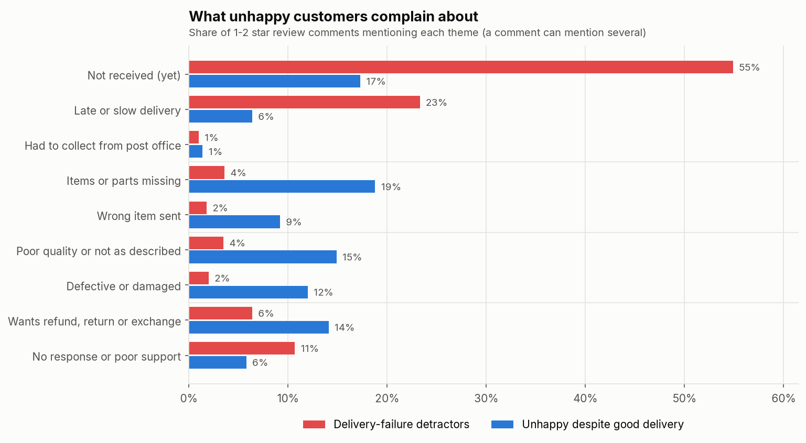
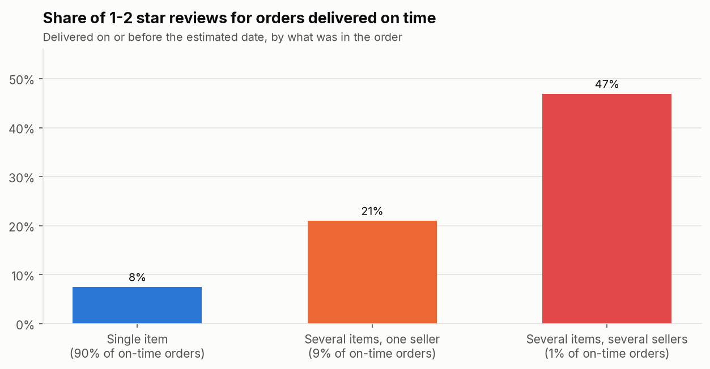
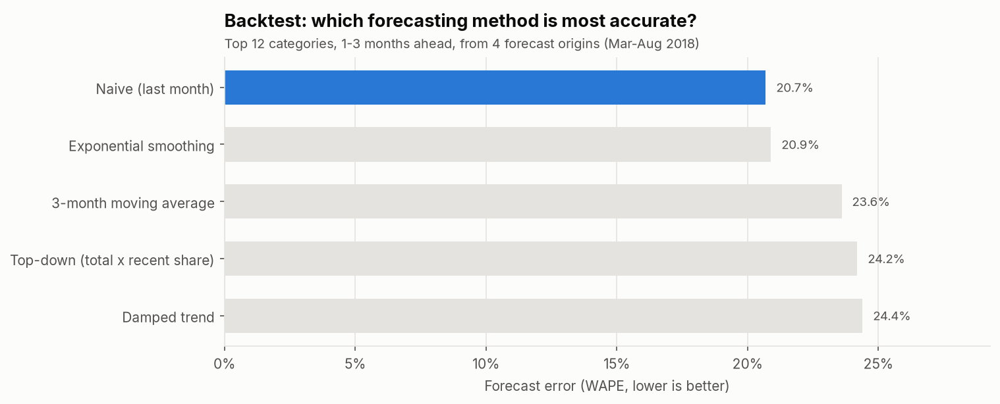
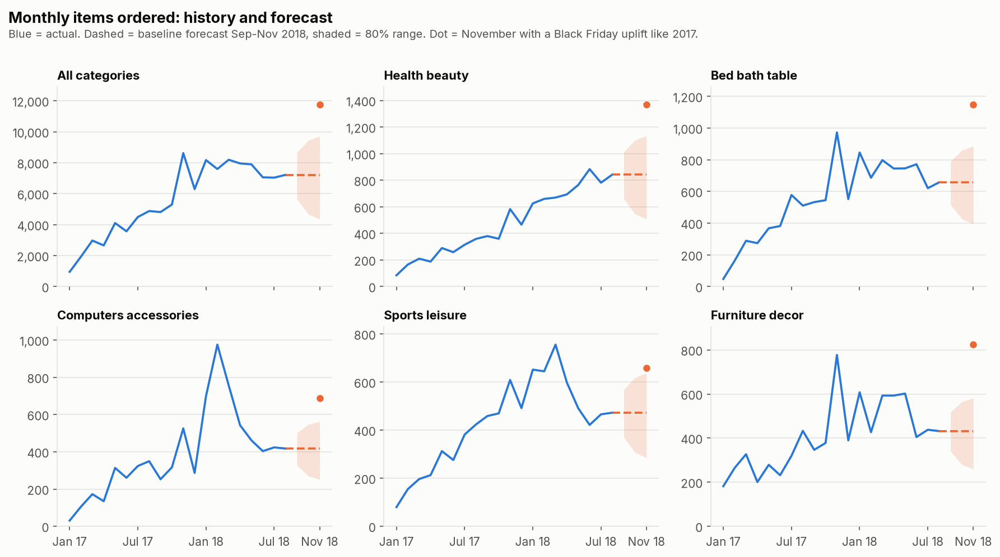

# Phase 4 findings: what unhappy customers say, and what demand is coming

Phase 4 has two parts:

- **Review text analysis** ([`analyse_reviews.py`](../scripts/analyse_reviews.py)): what do
  the two unhappy segments from phase 2 actually complain about, in their own words?
- **Demand forecasting** ([`forecast_demand.py`](../scripts/forecast_demand.py)): how many
  items will the largest categories sell over the next three months?

The findings feed into a one-page **[business memo](business_memo.md)** that pulls all four
phases together.

## Summary

1. **The two unhappy segments have different problems, and the text confirms it.**
   "Delivery-failure detractors" are mostly still waiting: 55% of their complaints say the
   order has not arrived, and 83% were written before the recorded delivery date.
   "Unhappy despite good delivery" customers mostly complain about **order accuracy**
   (27%: missing or wrong items) and the **product itself** (25%: defective, poor quality
   or not as described).
2. **Multi-item orders are a hidden fulfilment problem.** Orders with several items are 10%
   of on-time orders but get 27% of their 1-2 star reviews. With items from several sellers,
   47% of on-time orders get a 1-2 star review, against 7.5% for single items. 59% of the
   complaints about these orders say something was missing.
3. **"Delivered" does not always mean received.** 742 customers in the "good delivery"
   segment wrote, after their order was recorded as delivered, that they had not received it.
4. **Simple forecasts beat sophisticated ones.** On a backtest, "same as last month" (20.7%
   error) matched exponential smoothing and beat trend models (24.4%), which over-forecast
   by projecting 2017's launch growth into a market that had already plateaued.
5. **Demand is flat overall but shifting between categories.** The baseline is about 7,200
   items a month, rising to about 11,700 in November if Black Friday repeats 2017. Health and
   beauty and housewares grew 18-19% from spring to summer 2018, while electronics, garden
   tools, computer accessories and furniture fell 29-40%.

---

## Part A: review text analysis

### Set-up

| | |
|---|---|
| **Question** | What do the two unhappy segments from phase 2 complain about? |
| **Text** | 8,440 written comments on 1-2 star reviews of delivered orders: 2,348 from delivery-failure detractors, 6,092 from customers unhappy despite good delivery |
| **Language** | Portuguese, normalised before matching (lower case, accents and punctuation removed) |
| **Method** | nine complaint themes defined by transparent keyword rules; a comment can mention several |
| **Check** | rules compared once with 200 comments labelled by hand (100 per segment), drawn at random and kept separate from the comments used to write the rules |

Why rules rather than a topic model? With two segments and a business audience, every
theme needs to be explainable ("it matched *só recebi um*, 'I only received one'") and
measurable against a hand-labelled sample. Topic models on short, misspelt reviews tend to
produce clusters that are hard to name. A data-driven cross-check is included below.

### How good are the rules?

| Theme | Precision | Recall | Hand-labelled share: delivery failure | Hand-labelled share: good delivery |
|---|---|---|---|---|
| Not received (yet) | 0.92 | 0.76 | 67% | 18% |
| Late or slow delivery | 0.86 | 0.65 | 37% | 12% |
| Had to collect from post office | 1.00 | 0.62 | 4% | 4% |
| Items or parts missing | 0.95 | 0.81 | 4% | 22% |
| Wrong item sent | 1.00 | 0.69 | 2% | 14% |
| Defective or damaged | 0.95 | 0.91 | 2% | 20% |
| Poor quality or not as described | 0.75 | 0.52 | 3% | 20% |
| No response or poor support | 0.91 | 0.56 | 24% | 12% |
| Wants refund, return or exchange | 1.00 | 1.00 | 3% | 14% |

Precision is high (0.75 to 1.00): when a rule tags a theme, it is almost always right.
Recall is lower (0.52 to 1.00), because customers describe the same problem in many ways.
**The rule-based shares below are therefore conservative,** and the hand-labelled shares
show the likely true level. Both give the same ranking of problems.

*Source: [`review_theme_validation`](../outputs/tables/review_theme_validation.csv), labels in
[`data/labels`](../data/labels/review_theme_labels.csv).*

### What each segment complains about

| Theme group | Delivery-failure detractors | Unhappy despite good delivery |
|---|---|---|
| **Delivery** (not received, late, had to collect) | **68.9%** | 23.5% |
| **Order accuracy** (missing items, wrong item) | 5.3% | **27.4%** |
| **Product** (defective, poor quality, not as described) | 5.2% | **25.2%** |
| **Service** (no response, wants refund or exchange) | 16.2% | 18.3% |
| Any theme | 81.1% | 76.4% |

**Delivery-failure detractors are customers still waiting for their order.** 83% of their
complaints were submitted before the order's recorded delivery date. They describe missed
deadlines ("o prazo já passou", "the deadline has passed") and silence: 11% complain that
nobody answered them, almost twice the rate in the other segment (6%). This confirms the
phase 2 reading: it is a logistics problem, made worse by poor communication.

**Customers unhappy despite good delivery received the wrong thing, or not all of it.** The
biggest single theme is missing items (19%, or 22% by hand), usually in the form "comprei
dois e recebi apenas um" ("I bought two and received only one"). Wrong items (9%) and
defective or damaged products (12%) follow. Phase 2 suggested "the product, its description,
or the seller"; the text shows order accuracy matters as much as product quality.

**Some "good" deliveries were not received.** 17% of this segment's complaints say the order
never arrived, and 70% of those (742 comments) were written *after* the recorded delivery
date. These customers dispute a delivery that the system shows as complete, for example
"no site consta como entregue, porém não recebi nada" ("the site says delivered, but I
received nothing"). Some will be parcels left at the wrong address, some premature
"delivered" scans, and some partial deliveries the rules did not separate.

*Source: [`16_review_complaint_themes`](../sql/analysis/16_review_complaint_themes.sql).*

### Multi-item orders: on time, but incomplete

| Order (delivered on time) | Share of on-time orders | 1-2 star reviews | Share of on-time 1-2 star reviews | Complaints saying items were missing |
|---|---|---|---|---|
| Single item | 89.9% | 7.5% | 73.2% | 6.0% |
| Several items, one seller | 8.7% | 21.0% | 19.7% | 58.8% |
| Several items, several sellers | 1.4% | 46.9% | 7.1% | 59.6% |

Each Olist order has one delivery date, but items from different sellers (and sometimes
from the same seller) ship separately. The order can be marked delivered when the first
parcel arrives, while the customer is still missing the rest. That is consistent with the
59% of complaints about these orders that mention missing items.

**Size of the prize:** if on-time multi-item orders received low reviews at the
single-item rate (7.5% instead of 24.6%), there would be about 1,540 fewer 1-2 star reviews,
**12.5% of all low reviews on delivered orders**, without any change to delivery speed.

*Source: [`17_low_reviews_by_basket`](../sql/analysis/17_low_reviews_by_basket.sql).*

### Which categories have which problem

For customers unhappy despite good delivery, the main complaint differs by category
(categories with 150+ complaints):

| Main problem | Categories (share of complaints with that theme) |
|---|---|
| **Items or parts missing** | garden tools (33%), furniture and decor (27%), housewares (24%), sports and leisure (21%) |
| **Defective or damaged** | electronics (24%), telephony (20%), computer accessories (18%) |
| **Poor quality or not as described** | bed, bath and table (25%), toys (22%), watches and gifts (21%), cool stuff (20%) |

This gives each category team a different fix: packing checks for furniture and garden
tools, supplier quality and testing for electronics, and listing accuracy (photos, sizes,
materials) for textiles and gifts.

*Source: [`19_complaint_themes_by_category`](../sql/analysis/19_complaint_themes_by_category.sql).*

### Cross-check: the most distinctive words

As a check that does not depend on the rules, every word and two-word phrase was compared
between the two segments using weighted log-odds (higher z = more typical of that segment):

| More typical of delivery failures | z | | More typical of good-delivery complaints | z |
|---|---|---|---|---|
| *não recebi* (I did not receive) | 18.5 | | *veio* (it came [wrong / with...]) | 14.6 |
| *não chegou* (it has not arrived) | 15.0 | | *comprei* (I bought) | 9.4 |
| *entrega* (delivery) | 14.1 | | *só* (only) | 9.1 |
| *prazo* (deadline) | 11.3 | | *apenas* (only) | 8.4 |
| *hoje* (today) | 10.6 | | *qualidade* (quality) | 8.3 |
| *atraso* (delay) | 10.3 | | *errado* (wrong) | 7.4 |
| *não entregue* (not delivered) | 9.7 | | *outro* (another / the other) | 7.3 |
| *mês* (month) | 9.3 | | *defeito* (defect) | 6.8 |

The vocabulary splits along the same lines as the themes: waiting and deadlines on one
side, "only", "wrong", "another" and "defect" on the other.

*Source: [`review_distinctive_terms`](../outputs/tables/review_distinctive_terms.csv).*

---

## Part B: demand forecasting

### Set-up

| | |
|---|---|
| **Measure** | items ordered per month, by product category (cancelled and unavailable orders excluded) |
| **History** | Jan 2017 to Aug 2018: 20 complete months ([`12_mart_category_demand`](../sql/marts/12_mart_category_demand.sql)) |
| **Series** | the 12 largest categories (71% of 2018 items) and the marketplace total |
| **Methods** | naive (same as last month), 3-month moving average, exponential smoothing, damped-trend smoothing, top-down (forecast the total, split by recent category shares) |
| **Backtest** | rolling origin: train to Feb, Mar, Apr and May 2018, forecast 1-3 months ahead each time (144 category-months) |
| **Choice** | lowest WAPE (weighted absolute percentage error) across the 12 categories |

Twenty months is too short to estimate seasonality, so only simple methods are compared,
and every one is judged on months it did not see.

### Backtest results

| Method | WAPE (categories) | Bias | 1 month ahead | 3 months ahead | WAPE (total) |
|---|---|---|---|---|---|
| **Naive (last month)** | **20.7%** | +6.1% | 14.5% | 26.6% | 8.0% |
| Exponential smoothing | 20.9% | +5.8% | 15.1% | 26.4% | 7.4% |
| 3-month moving average | 23.6% | +3.7% | 19.0% | 28.5% | 8.3% |
| Top-down (total x recent share) | 24.2% | +8.1% | 18.7% | 30.2% | 9.9% |
| Damped trend | 24.4% | +14.3% | 16.9% | 31.6% | 9.9% |

- **The naive forecast and exponential smoothing are effectively tied.** The rule picked naive;
  the difference is well within the noise of 144 test points.
- **Trend models do worst.** They learn the steep 2017 growth and keep projecting it, so they
  over-forecast by 14% in a year when demand flattened. As in phase 3, the simpler model wins.
- **Every method over-forecasts** (positive bias), because demand in most large categories was
  falling from its early-2018 peak during the test period.
- **The total is much easier to forecast (8% error) than individual categories (21%).**
  Category-level plans need wider safety margins.

*Source: [`forecast_backtest`](../outputs/tables/forecast_backtest.csv).*

### Forecasts for September to November 2018

The 80% ranges come from the chosen method's own backtest errors: 1 month ahead, actual
demand fell between 0.78 and 1.20 times the forecast 80% of the time; 3 months ahead,
between 0.60 and 1.35.

| Category | Share of 2018 items | Momentum (Jun-Aug vs Mar-May) | Baseline per month | November with Black Friday |
|---|---|---|---|---|
| **All categories** | 100% | -11.4% | 7,216 | 11,744 |
| Health and beauty | 9.7% | **+17.8%** | 843 | 1,368 |
| Bed, bath and table | 9.6% | -10.4% | 658 | 1,147 |
| Computer accessories | 7.7% | **-29.3%** | 418 | 688 |
| Sports and leisure | 7.4% | **-26.2%** | 473 | 660 |
| Furniture and decor | 6.7% | **-28.7%** | 432 | 824 |
| Housewares | 6.6% | **+18.7%** | 625 | 1,073 |
| Watches and gifts | 6.0% | -9.3% | 416 | 643 |
| Auto | 4.3% | +0.7% | 374 | 631 |
| Telephony | 3.8% | -18.6% | 277 | 433 |
| Garden tools | 3.1% | **-40.3%** | 137 | 249 |
| Electronics | 3.0% | **-34.6%** | 120 | 232 |
| Baby | 2.9% | -7.3% | 216 | 337 |

**Black Friday:** November 2017 sold 1.63 times as many items as October 2017. The November
scenario applies each category's 2017 uplift, shrunk towards that marketplace figure for
smaller categories. Furniture (2.06x) and garden tools (1.95x) roughly doubled, electronics
nearly tripled (2.92x), and sports and leisure rose by only 1.30x. Because the business was
still growing quickly in late 2017, part of that uplift was growth rather than Black Friday,
so treat the scenario as the upper end of a plausible range, not a point forecast.

**The 2017 peak broke delivery.** The share of items arriving late tripled, from 3.9% for
October 2017 purchases to 11.9% for November, and reached 18.3% in bed, bath and table,
16.8% in baby products and 14.6% in furniture and decor.

*Source: [`category_demand_forecast`](../outputs/tables/category_demand_forecast.csv),
[`18_category_demand_trends`](../sql/analysis/18_category_demand_trends.sql).*

### What this means

- **Plan November capacity for up to 1.6 times a normal month.** That means carriers and seller
  stock, especially in furniture, garden tools and electronics, where 2017's uplift was largest.
  Last year the peak tripled the late-delivery rate, and late orders drive a third of low
  reviews (phase 1), so Black Friday is a satisfaction risk as well as a sales opportunity.
- **Recruit sellers where demand is growing.** Health and beauty and housewares are the
  largest growing categories. Falling categories (electronics, computer accessories, garden
  tools) need a commercial explanation (pricing, stock, competition) before more spend.
- **Don't expect a model to predict 2019 from 20 months.** The useful outputs are the ranges and
  the Black Friday scenario. A full year of plateau data would allow proper seasonal models.

---

## Recommendations

1. **Make multi-item orders visible and complete.** Show "arrives in N packages" at checkout
   and in tracking, give each parcel its own tracking, and mark an order delivered only when
   every parcel has arrived. Worth about 1,540 fewer low reviews (12.5% of the total).
2. **Add order accuracy to the seller scorecard.** Missing-item and wrong-item complaints per
   1,000 orders sit naturally next to late dispatch (phase 3), and point to packing problems
   that sellers control.
3. **Tighten proof of delivery.** Require a photo or signature for "delivered" scans, and give
   customers a one-click "not received" claim, so disputed deliveries are caught before they
   become 1-star reviews.
4. **Answer late customers before they ask.** Delivery-failure detractors complain about silence
   as well as delay: a proactive message and a revised date (phase 2 recommendation) targets
   both.
5. **Give category teams their specific problem:** packing for furniture and garden tools,
   supplier quality for electronics and telephony, listing accuracy for textiles and gifts.
6. **Prepare for Black Friday** with carrier capacity and seller stock for up to 1.6x a normal
   month, prioritising the categories with the largest 2017 uplift.

## Limitations

- **Rules undercount.** Recall is 0.52 to 1.00 by theme, so shares are conservative. Precision is
  high, so the ranking of problems is reliable. The hand-labelled sample is 200 comments,
  labelled by one person.
- **Only customers who write comments are heard.** About three quarters of low-score reviews
  in these segments have text; customers who write may differ from those who do not.
- **Order-level delivery dates hide parcel-level detail.** The data cannot show when each parcel
  arrived, so the multi-item finding is inferred from the text and the review gap.
- **Short history.** Twenty months, one Black Friday and a business in transition from growth to
  plateau limit any forecast. The ranges, not the point values, should drive planning.
- **Associations, not causes,** as in earlier phases: for example, multi-item orders may also
  differ in category or customer type.
